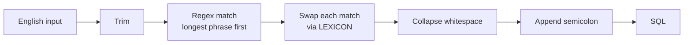

# Text to SQL

A tiny, dependency-free Python translator that turns plain English into SQL using a **relative-word lexicon**. Words such as `everything` map straight to SQL tokens such as `*`.

```text
Input English wording: Select everything from table {$name}
SELECT * FROM {$name};
```

## Table of contents

- [Features](#features)
- [How it works](#how-it-works)
- [Quick start](#quick-start)
- [Usage](#usage)
- [Vocabulary](#vocabulary)
- [Examples](#examples)
- [Design notes](#design-notes)
- [Known limitations](#known-limitations)
- [Extending the lexicon](#extending-the-lexicon)
- [Project structure](#project-structure)
- [Roadmap](#roadmap)

## Features

- **Zero dependencies.** Only the standard library (`re`).
- **Relative words.** `everything`, `all`, `unique`, `greater than`, `sorted by`, and more.
- **Multi-word phrases.** Longest phrase wins, so `greater than` is never split into smaller matches.
- **Case-insensitive.** `SELECT`, `Select`, and `select` behave the same.
- **Template placeholders.** `{$name}` passes through untouched.
- **Normalised output.** Whitespace is collapsed and exactly one trailing `;` is appended.
- **Importable.** Use it as a CLI prompt or call `translate()` from your own code.

## How it works



1. **Lexicon.** `LEXICON` is a plain dictionary: relative word or phrase → SQL token.
2. **Pattern.** Every key is regex-escaped, sorted **longest first**, and joined into one alternation wrapped in word boundaries (`\b`).
3. **Substitution.** `re.sub` replaces each match with its SQL token. The lookup is lower-cased, so matching is case-insensitive.
4. **Clean-up.** Runs of whitespace collapse to a single space. Any trailing semicolons are stripped, then one is added back.

Words that are not in the lexicon (table names, column names, values) are left exactly as typed.

## Quick start

Requires **Python 3.8+**.

```bash
git clone https://github.com/sujit-waghmare/text-to-sql.git
cd text-to-sql
python lexicon.py
```

```text
Input English wording: show everything from users sorted by alphabet ascending
SELECT * FROM users ORDER BY alphabet ASC;
```

## Usage

### Interactive

```bash
python lexicon.py
```

The script prompts once, prints the SQL, and exits:

```python
if __name__ == "__main__":
    print(translate(input("Input English wording: ")))
```

### As a module

```python
from lexicon import translate

translate("find unique city from customers")
# 'SELECT DISTINCT city FROM customers;'
```

`translate(text: str) -> str` is the only public function.

## Vocabulary

Matching is case-insensitive and whole-word.

### Selection

| English | SQL |
| --- | --- |
| `select`, `show`, `get`, `find`, `list` | `SELECT` |
| `everything`, `all` | `*` |
| `unique`, `distinct` | `DISTINCT` |

### Source

| English | SQL |
| --- | --- |
| `from` | `FROM` |
| `table` | *(removed)* |

### Filtering

| English | SQL |
| --- | --- |
| `where`, `with` | `WHERE` |
| `and` | `AND` |
| `or` | `OR` |
| `not` | `NOT` |
| `between` | `BETWEEN` |
| `like`, `containing` | `LIKE` |

### Comparison

| English | SQL |
| --- | --- |
| `greater than`, `more than` | `>` |
| `less than`, `fewer than` | `<` |
| `at least` | `>=` |
| `at most` | `<=` |
| `equals`, `is` | `=` |

### Aggregation

| English | SQL |
| --- | --- |
| `count of`, `number of` | `COUNT(*)` |
| `average` | `AVG` |
| `total`, `sum` | `SUM` |
| `highest` | `MAX` |
| `lowest` | `MIN` |

### Ordering, grouping, limiting

| English | SQL |
| --- | --- |
| `sorted by`, `ordered by` | `ORDER BY` |
| `grouped by`, `per` | `GROUP BY` |
| `ascending` | `ASC` |
| `descending` | `DESC` |
| `top`, `first`, `limit` | `LIMIT` |

## Examples

| English | SQL |
| --- | --- |
| `Select everything from table {$name}` | `SELECT * FROM {$name};` |
| `show all from users` | `SELECT * FROM users;` |
| `get name from users where age greater than 18` | `SELECT name FROM users WHERE age > 18;` |
| `find unique city from customers` | `SELECT DISTINCT city FROM customers;` |
| `show everything from orders top 5` | `SELECT * FROM orders LIMIT 5;` |
| `show everything from users sorted by alphabet ascending` | `SELECT * FROM users ORDER BY alphabet ASC;` |

## Design notes

**Why longest phrase first?** Python's regex alternation takes the first branch that matches, not the longest. Sorting keys by length (descending) guarantees `greater than` is tried before any shorter key.

**Why word boundaries?** `\b` stops substitutions inside larger words. For example, `all` will not fire inside `calls`.

**Why can a key map to an empty string?** `table` maps to `""` so that natural phrasing such as `from table users` yields `FROM users`. The extra space left behind is removed by the whitespace collapse.

**Why a dictionary?** It keeps the vocabulary data-driven. Adding a synonym is one line, with no logic changes.

## Known limitations

This is a lexical substitution engine, not a parser. Be aware of the following:

- **Output is a single line.** Clauses are not split across lines.
- **Clause order is not fixed.** SQL comes out in the same order you typed it.
- **Aggregates are not wrapped.** `average salary` becomes `AVG salary`, not `AVG(salary)`.
- **Values are not quoted.** `status is active` becomes `status = active`.
- **Words are context-free.** `is` always becomes `=`, and `with` always becomes `WHERE`.
- **Placeholders can collide.** A placeholder such as `{$total}` would have `total` replaced with `SUM`, because the word boundary sits between `$` and `t`. Prefer names outside the lexicon.
- **No validation.** The result is not checked for correctness or safety.

## Extending the lexicon

Add an entry to `LEXICON`. Nothing else changes, because the pattern is rebuilt from the dictionary at import time.

```python
LEXICON = {
    # ...
    "order by": "ORDER BY",
    "asc": "ASC",
    "desc": "DESC",
}
```

Guidelines:

- Use lowercase keys.
- Keep each key unambiguous. A word that is common in column names (like `first`) can cause surprises.
- Multi-word keys are fine. Ordering is handled automatically.

## Project structure

```text
text-to-sql/
├── lexicon.py   # LEXICON, translate(), and the CLI prompt
└── README.md
```

## Roadmap

Ideas for future work:

- [ ] Clause-aware output (`SELECT`, `FROM`, `ORDER BY` on separate lines, in canonical order)
- [ ] Wrap aggregate targets, e.g. `AVG(salary)`
- [ ] Quote string values
- [ ] Unsafe-statement validator (block `DROP`, `DELETE`, `UPDATE` without `WHERE`, and similar)
- [ ] Context-aware autosuggest while typing
- [ ] Unit tests for every lexicon entry
